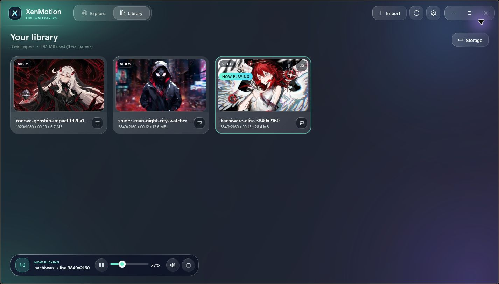

# XenMotion

**والپیپر زنده برای ویندوز، با تنظیم خودکار کیفیت بر اساس اندازه‌گیری واقعی و رابط بومی WinUI 3.**

**فارسی** · [English](README.md) · [دانلود بتای ۰۵](https://github.com/VY1-pick/XenMothon/releases/tag/v0.9.0-beta.5) · [گزارش مشکل](https://github.com/VY1-pick/XenMothon/issues)



*نمای Library در نسخهٔ بتا؛ والپیپرهای تصویر نمونهٔ فایل‌های واردشده توسط کاربر هستند و همراه نصاب ارائه نمی‌شوند.*

XenMotion تصویر و ویدیوی محلی را به والپیپر دسکتاپ تبدیل می‌کند. فایل‌های خودت را وارد کن، در کتابخانه مدیریت کن، پخش و صدا را کنترل کن و مشخص کن وقتی برنامه‌های دیگر باز هستند والپیپر چقدر منابع مصرف کند.

این نسخه **بتای عمومی ۰۵** است. کد و فایل‌های ریلیز برای همه در دسترس‌اند. سازگاری سخت‌افزار و عملکرد واقعی تصویر و صدا همچنان به بازخورد تست‌کنندگان نیاز دارد.

> بتای ۰۵ با نسخهٔ **0.9.0-beta.5** شامل کاتالوگ آنلاین، افزودن از لینک، زمان‌بندی و چرخش، والپیپر هر برنامه و بررسی به‌روزرسانی است. [توضیحات انتشار](docs/engineering/beta5-release-notes.md) را ببین.

نصاب امضای دیجیتال ناشر ندارد و ویندوز ممکن است هشدار نشان بدهد. مراحل امضا در [code-signing.md](docs/engineering/code-signing.md) توضیح داده شده است.

## امکانات

- نمایش تصویر و ویدیو با موتور بومی ویندوز.
- واردکردن فایل، کشیدن و رهاکردن، پیش‌نمایش، جست‌وجو و فیلتر در Explore و ابزارهای مدیریت فضای کتابخانه.
- نمایش با D3D11 و استفاده از فریم‌های روی GPU در مسیرهای پشتیبانی‌شده؛ انتقال از CPU به‌عنوان مسیر جایگزین.
- توقف و ادامه، تکرار، سرعت پخش، بی‌صداکردن و کنترل ولوم از صفر تا صد درصد.
- تنظیم روشنایی، کنتراست، اشباع رنگ، نحوهٔ نمایش، رزولوشن رندر، فیلتر و شارپنس.
- اندازه‌گیری خودکار کیفیت و ذخیرهٔ پروفایل برای ویدیوی واقعی و شرایط نمایشگر.
- توقف پشت پنجرهٔ تمام‌صفحه، پنجرهٔ ماکسیمایز، پوشیده‌شدن دسکتاپ و هنگام استفاده از باتری.
- اجرا در تری، راه‌اندازی اختیاری با ویندوز و بازیابی والپیپر ذخیره‌شده.
- زمان‌بندی و چرخش والپیپر: بازه‌های ساعتی روزانه برای هر نمایشگر به‌همراه چرخش بین چند والپیپر با فاصلهٔ زمانی دلخواه.
- والپیپر مخصوص هر برنامه: هنگام فعال‌بودن یک برنامه، والپیپر دیگری نمایش داده می‌شود.
- افزودن از لینک: دانلود تصویر یا ویدیو از آدرس ‎HTTP(S) با قابلیت ادامه و نگه‌داشتن آن در کتابخانه.
- کاتالوگ آنلاین در دو شکل: API زندهٔ سرور یا یک فایل ثابت `catalog.json` روی هر میزبان ‎HTTPS.
- بررسی به‌روزرسانی درون‌برنامه‌ای که فقط اطلاع می‌دهد و هیچ‌وقت چیزی دانلود یا نصب نمی‌کند.

## پیش‌نیازها

| مورد | نیاز |
| --- | --- |
| سیستم‌عامل | ویندوز ۱۰ بیلد 19041 یا جدیدتر، یا ویندوز ۱۱ |
| معماری | x64؛ این ریلیز بستهٔ ARM64 یا x86 ندارد |
| گرافیک و رسانه | درایور سالم ویندوز و پشتیبانی Media Foundation از کدک فایل انتخاب‌شده |
| نصب | برای کاربر فعلی؛ بدون نیاز به دسترسی مدیر |
| محیط‌های اجرا | داخل نصاب؛ نصب جداگانهٔ Python یا ‎.NET لازم نیست |
| اینترنت | برای دانلود گیت‌هاب و سرویس‌های آنلاینِ تنظیم‌شده؛ واردکردن و پخش فایل محلی آفلاین کار می‌کند |

هنوز حداقل سخت‌افزار تأییدشده‌ای اعلام نشده است. کدک، بیت‌ریت، نرخ فریم و ابعاد نمایشگر هم در کنار رزولوشن روی مصرف منابع اثر دارند. تنظیم خودکار به انتخاب تنظیمات عملی کمک می‌کند، اما پخش روان 4K روی همهٔ کامپیوترها را تضمین نمی‌کند.

## نصب و شروع

۱. [ریلیز 0.9.0-beta.5](https://github.com/VY1-pick/XenMothon/releases/tag/v0.9.0-beta.5) را باز کن.

۲. فایل `XenMotion-0.9.0-beta.5-Setup-x64.exe` را دانلود کن. فایل‌های `SHA256SUMS.txt` و `BETA-REVIEW.md` هم در ریلیز موجودند.

۳. نصاب را اجرا و مسیر نصب را انتخاب کن. مسیر پیش‌فرض `%LOCALAPPDATA%\Programs\XenMotion` است.

۴. برنامه را از میان‌بر باز کن. در **Library** روی **Import** بزن یا فایل را داخل پنجره بکش و رها کن.

۵. روی کارت فایل **Set as wallpaper** را انتخاب کن. در بخش **Now Playing** پخش را متوقف کن، ولوم را تغییر بده، صدا را قطع کن یا نمایش والپیپر را پایان بده.

۶. **Settings** را باز کن، تنظیمات پخش و عملکرد را انتخاب کن و تغییرات را با دکمهٔ **Apply changes** ثبت و اعمال کن.

نصاب بتا **امضای دیجیتال ناشر ندارد**؛ ممکن است ویندوز هشدار ناشر یا اعتبار فایل نشان بدهد. هش صحت فایل را بررسی می‌کند، اما هویت ناشر را تأیید نمی‌کند. برای نصب بتا حفاظت ویندوز را غیرفعال نکن.

برای بررسی هش در PowerShell، از پوشهٔ دانلود دستور زیر را اجرا کن و نتیجهٔ کامل را با `SHA256SUMS.txt` مقایسه کن:

```powershell
Get-FileHash -Algorithm SHA256 -LiteralPath .\XenMotion-0.9.0-beta.5-Setup-x64.exe
```

بستن پنجره برنامه را به تری کنار ساعت می‌برد. از آیکن تری دوباره بازش کن. برای خروج کامل موتور والپیپر، **Exit XenMotion** را از منوی تری انتخاب کن. توقف همهٔ والپیپرها، والپیپر ذخیره‌شده برای شروع بعدی را هم پاک می‌کند.

## فایل‌های قابل واردکردن

انتخابگر فایل این پسوندها را می‌پذیرد:

| تصویر | ویدیو |
| --- | --- |
| JPG، JPEG، PNG، BMP، WEBP | MP4، WEBM، WMV، AVI، MOV |

پسوند فایل به‌تنهایی تضمین پشتیبانی نیست. پخش ویدیو و صدا به کدک‌های داخل فایل و کدک‌های موجود در ویندوز بستگی دارد. برای تست پخش از یک فایل محلی سالم استفاده کن.

کاتالوگ پیش‌فرض Explore شامل پیش‌نمایش‌های نمایشی است. ورودی‌های ویدیویی آن **فقط پیش‌نمایش** هستند و فایل ویدیویی قابل دانلود ندارند. ویدیوی خودت را وارد کن یا یک کاتالوگ واقعی آنلاین تنظیم کن. آثار تصویر متعلق به سازندگانشان هستند؛ مجوز برنامه شامل این رسانه‌ها نمی‌شود.

## سرور کاتالوگ

با اجرای `powershell -File .\tools\Start-CatalogServer.ps1` سرور محلی کاتالوگ و دانلود در آدرس `http://127.0.0.1:5188` اجرا می‌شود. نمونهٔ محلی دو تصویر قابل دانلود دارد. برای افزودن رسانه، اتصال XenMotion و شرایط استقرار، [راهنمای سرور](docs/engineering/catalog-server.md) را ببین.

### حالت‌های کاتالوگ آنلاین

در Settings → General → **Wallpaper catalog** مشخص کن Explore از کجا بخواند. هر سه حالت پیشرفت، لغو و ادامهٔ دانلود دارند و کاتالوگ آفلاین همیشه به‌عنوان جایگزین در دسترس است:

| حالت | منبع |
| --- | --- |
| کاتالوگ آفلاین داخلی | کاتالوگ همراه برنامه؛ بدون نیاز به شبکه کار می‌کند. |
| سرور کاتالوگ آنلاین | شش مسیر زندهٔ `api/v1/catalog/*` که `XenMotion.Server` ارائه می‌کند. |
| فایل کاتالوگ آنلاین | یک `catalog.json` ثابت به‌همراه رسانه‌های نسبی روی هر میزبان ‎HTTPS یا CDN. |

هر دو حالت آنلاین از یک موتور فیلتر و مرتب‌سازی مشترک استفاده می‌کنند؛ پس جست‌وجو، دسته‌ها و فهرست‌ها در هر دو یکسان رفتار می‌کنند.

### میزبانی ثابت

`powershell -File .\tools\Start-CatalogServer.ps1 -Static` پوشهٔ کاتالوگ را دقیقاً مثل یک CDN یا فضای ذخیره‌سازی ثابت ارائه می‌کند:

```text
catalog-directory/
  catalog.json     # دسته‌ها و آیتم‌ها (همان ساختار ورودی سرور)
  media/           # تصاویر و ویدیوهایی که مسیرشان نسبی است
```

هدرهای `ETag` قوی، `Accept-Ranges` و پاسخ `Range` توسط همین میزبانی تأمین می‌شوند؛ همان چیزی که دانلود قابل‌ادامه لازم دارد. همین پوشه را روی هر میزبانی آپلود کن و **Online catalog file** را به `catalog.json` آن اشاره بده. کاتالوگ و رسانه‌های آن را روی یک آدرس ‎HTTPS قابل دسترس قرار بده؛ مانیفست به‌روزرسانی جداگانه در همین مخزن عمومی منتشر می‌شود.

## کنترل‌های نسخهٔ بتا

تنظیمات در پنجرهٔ مستقل باز می‌شوند و ریست آن‌ها کتابخانه و ادیت شخصی را پاک نمی‌کند. در Playback، بخش Global wallpaper edits تنظیمات رنگ، شفافیت، چرخش افقی، تراز و پخش را سراسری می‌کند. در ادیت هر والپیپر می‌توان بین تنظیم سراسری و ادیت شخصیِ حفظ‌شده جابه‌جا شد. تا فعال‌شدن تنظیم سراسری، گزینهٔ مربوط خاموش و راهنمای آن قابل مشاهده است. عکس و ویدیو هر دو ادیت تصویری و ریست دارند.

در Library گزینهٔ Select برای انتخاب چندتایی، انتخاب همه و حذف گروهی با تأیید اضافه شده است. تک‌کلیک ترای منو را باز می‌کند و دابل‌کلیک برنامه را. منو گزینهٔ تنظیمات و ابزار اسکرین‌شات ویندوز دارد. توقف هنگام Screen Saver، صرفه‌جویی انرژی و Remote Desktop قابل تنظیم است. پیش‌نمایش متحرک پیش‌فرض دستی است تا روی سیستم ضعیف تبدیل ویدیو بی‌دلیل اجرا نشود.

در Library گزینهٔ **From link** یک والپیپر را از آدرس مستقیم تصویر یا ویدیو دانلود می‌کند، انتقال نیمه‌کاره را ادامه می‌دهد، نوع واقعی فایل را تشخیص می‌دهد و سپس همان مسیر معمول افزودن (تشخیص تکرار، هش، تصویر بندانگشتی، ذخیره‌سازی و متادیتا) را اجرا می‌کند. فقط رسانه‌ای را دانلود کن که اجازهٔ دانلودش را داری.

در Settings → **Schedule** می‌توانی والپیپرها را به بازه‌های ساعتی روزانه (بازه‌ای که از نیمه‌شب بگذرد هم مجاز است) گره بزنی و بین چند والپیپر با فاصلهٔ زمانی مشخص بچرخی؛ برای هر نمایشگر جداگانه. بازهٔ زمانی همیشه بر چرخش اولویت دارد و اگر هیچ‌کدام فعال نباشد، والپیپر ذخیره‌شده بازمی‌گردد. دکمهٔ **Show the next wallpaper now** چرخش را فوراً جلو می‌برد.

در Settings → **Apps** می‌توانی برای هر برنامه یک والپیپر جدا تعیین کنی؛ مثلاً والپییری آرام هنگام اجرای یک بازی یا ویرایشگر. تطبیق بر اساس نام فایل اجرایی است (`code` یا `chrome.exe`) و با از فوکوس خارج‌شدن برنامه، والپیپر ذخیره‌شده برمی‌گردد. هیچ چیزی از این سوییچ موقت در والپیپر شروع بعدی ذخیره نمی‌شود.

در Settings → **Updates** یک مانیفست ریلیز روی ‎HTTPS بررسی می‌شود و نتیجه با لینک توضیحات نسخه نمایش داده می‌شود. XenMotion فقط اطلاع می‌دهد و هیچ‌وقت نسخه‌ای را دانلود یا نصب نمی‌کند. مانیفست در [`docs/updates/update.json`](docs/updates/update.json) منتشر می‌شود و می‌توان آن را به هر آدرس ‎HTTPS دیگری تغییر داد.

نصب‌کننده [شرایط بتا](docs/legal/BETA-TERMS.fa.txt) را ارائه می‌کند؛ حقوق اجزای دارای [مجوز MIT](LICENSE) محفوظ می‌ماند. نصب بی‌صدا به `/ACCEPTTERMS=yes` نیاز دارد. جابه‌جایی کتابخانه برای اجرای بعد ذخیره می‌شود و پوشهٔ قبلی به‌عنوان نسخهٔ بازیابی باقی می‌ماند.

## کیفیت خودکار چطور کار می‌کند؟

در نصب جدید، نزدیک‌ترین حالت ثابت به رزولوشن نمایشگر اصلی انتخاب می‌شود. هیچ بنچمارکی در اجرای اول انجام نمی‌شود و حالت خودکار پیش‌فرض خاموش است.

پس از اعمال یک ویدیو، در تنظیمات مستقل برنامه از بخش Performance گزینهٔ Automatic را بزنید. پس از تأیید، تست تا حدود ۳٫۵ دقیقه زمان می‌برد؛ پخش متوقف و کنترل‌های برنامه موقتاً مسدود می‌شوند. امکان لغو، نمایش نتیجه و توضیح Advanced وجود دارد.

اولویت الگوریتم رزولوشن مؤثر نمایشگر است، بین گزینه‌هایی که بررسی منابع و تحویل فریم را پاس می‌کنند. جست‌وجو حداکثر یک پله رزولوشن و مقدار کمی مقیاس رندر را پایین می‌آورد؛ اگر نتیجهٔ معتبر پیدا نشود، تنظیمات قبلی حفظ می‌شوند. تست برای Fill و سرعت عادی است و نتیجهٔ آن به‌تنهایی تأیید روانی دسکتاپ واقعی یا هماهنگی صدا نیست.

## تنظیمات کیفیت و عملکرد

پیش‌فرض پریست‌ها در این بتا:

| پریست | سقف FPS | سقف ارتفاع ویدیو | مقیاس رندر | FPS روی باتری |
| --- | ---: | ---: | ---: | ---: |
| Economy | ۱۵ | 720p | ۱۰۰٪ | ۱۵ |
| Balanced | ۲۴ | 1080p | ۱۰۰٪ | ۲۰ |
| High | ۳۰ | 1440p | ۱۰۰٪ | ۲۴ |
| Ultra | ۶۰ | 2160p / 4K | ۱۰۰٪ | ۳۰ |
| Custom | انتخاب کاربر | انتخاب کاربر | انتخاب کاربر | انتخاب کاربر |

این‌ها پیش‌فرض‌های ثابت هستند، نه تضمین عملکرد اندازه‌گیری‌شده. انتخاب اجرای اول فقط با رزولوشن نمایشگر انجام می‌شود. Economy جلوهٔ شیشه‌ای و فیلتر کیفیت بالا را خاموش می‌کند، شارپنس ملایم دارد و روی باتری پخش را متوقف می‌کند.

| کنترل | اثر |
| --- | --- |
| FPS | نرخ ارائهٔ فریم؛ سقف بالاتر فریم جدیدی به فایل منبع اضافه نمی‌کند |
| Video-height limit | بیشترین ارتفاع درخواستی برای پخش ویدیو |
| Render scale | رزولوشن رندر نسبت به دسکتاپ؛ کاهش آن جزئیات و کار رندر را کمتر می‌کند |
| Hardware decoding | درخواست دیکود سخت‌افزاری؛ پشتیبانی به ویندوز، کدک و درایور وابسته است |
| Filtering / sharpness | نمونه‌برداری مجدد و ظاهر لبه‌ها؛ شارپنس جزئیات ازدست‌رفته را بازیابی نمی‌کند |
| Brightness / contrast / saturation | روشنایی، کنتراست و اشباع رنگ والپیپر |
| Scaling | Fill صفحه را با برش پر می‌کند؛ Fit کل تصویر را با احتمال حاشیه نشان می‌دهد؛ Stretch نسبت ابعاد را تغییر می‌دهد؛ Center تصویر را وسط می‌گذارد؛ Span در رابط وجود دارد اما رفتار مستقل چندمانیتوره تأیید نشده است |
| توقف تمام‌صفحه / ماکسیمایز | توقف هنگام تشخیص پنجرهٔ واجد شرایط |
| توقف هنگام پوشیدگی | انتخاب پوشیدگی کامل یا درصد سفارشی پوشش صفحه |
| سیاست باتری | سقف FPS روی باتری و توقف اختیاری هنگام استفاده از باتری |
| فاصلهٔ بررسی فعالیت | فاصلهٔ بررسی دوره‌ای، در کنار اعلان تغییر پنجرهٔ فعال |
| Glass effects | ظاهر رابط؛ مستقل از رزولوشن والپیپر |

برای سیستم ضعیف، از Economy شروع کن و توقف هنگام پوشیدگی را با درصد سفارشی پایین فعال کن. مثلاً **۱٪** حتی با یک پنجرهٔ کوچک پخش را متوقف می‌کند. سیاست تمام‌صفحه و ماکسیمایز جدا هستند؛ اگر آن‌ها هم باید باعث توقف شوند فعال نگهشان دار.

برای اندازه‌گیری قابل‌اعتمادتر، اولین سنجش را با دسکتاپ در دسترس و بدون بازی یا کار سنگین پس‌زمینه انجام بده. برای کنترل دستی، تنظیم خودکار را خاموش کن، مقادیر را تغییر بده و ذخیره کن.

## ذخیره‌سازی، حریم خصوصی و حذف

تنظیمات، اطلاعات کتابخانه و گزارش‌های کیفیت محلی هستند. نصب جدید از `%LOCALAPPDATA%\XenMotion` استفاده می‌کند؛ کتابخانهٔ قبلی `%LOCALAPPDATA%\Lumen` ممکن است برای سازگاری دوباره استفاده شود. مسیر کتابخانه از ابزارهای Storage قابل انتخاب است.

گزارش‌های `QualityTuning` می‌توانند مسیر فایل، اطلاعات رسانه، سخت‌افزار و درایور و آمار سنجش را داشته باشند. سنجش قطع‌شده ممکن است فایل تشخیصی محلی باقی بگذارد. قبل از اشتراک‌گذاری گزارش آن را بررسی کن.

کاتالوگ آنلاین، آپلود سازنده و بررسی به‌روزرسانی به آدرس سرویس تنظیم‌شده نیاز دارند؛ سرویس میزبانی‌شدهٔ آماده همراه برنامه نیست. به‌روزرسانی‌ها به HTTPS نیاز دارند و خودکار نصب نمی‌شوند. حذف کارت Library نسخهٔ مدیریت‌شدهٔ کتابخانه را حذف می‌کند و فایل اصلی واردشده حفظ می‌شود. حذف برنامه هم کتابخانه و تنظیمات کاربر را نگه می‌دارد و معادل بازنشانی داده‌ها نیست.

## عیب‌یابی

| مشکل | بررسی پیشنهادی |
| --- | --- |
| والپیپر دیده نمی‌شود | فایل محلی سالم وارد کن؛ اعمال‌شدن در Library، وضعیت توقف و پوشیدگی دسکتاپ را بررسی کن و مطمئن شو موتور والپیپر دیگری رقابت نمی‌کند |
| ویدیوی 4K لگ دارد | تنظیم خودکار و گزارش آن را بررسی کن؛ سقف FPS، ارتفاع یا مقیاس را کمتر کن و با فایل کم‌بیت‌ریت مقایسه کن؛ رزولوشن تنها عامل هزینهٔ دیکود نیست |
| والپیپر در توقف مانده | تنظیمات تمام‌صفحه، ماکسیمایز، درصد پوشیدگی و باتری را بررسی کن؛ پنجرهٔ پوشاننده در پس‌زمینه هم ممکن است شرط توقف را برقرار کند |
| صدا پخش نمی‌شود | میوت، ولوم Now Playing، ولوم و خروجی صدای ویندوز و وجود ترک صوتی قابل پخش را بررسی کن |
| برنامه ظاهراً بسته شده | تری کنار ساعت را بررسی کن؛ بستن پنجره آن را مخفی می‌کند و Exit از تری خروج کامل است |
| نتیجهٔ خودکار به تعویق افتاده | زیر بار کمتر دوباره امتحان کن؛ تنظیمات فعلی فعال می‌مانند و پروفایل نامعتبر اعمال نمی‌شود |
| ویدیوی Explore دانلود نمی‌شود | ویدیوهای کاتالوگ محلی فقط پیش‌نمایش‌اند؛ فایل واقعی وارد کن |

تغییر ظاهری موقعیت ویدیو به‌تنهایی اثبات خرابی توقف نیست؛ سیاست توقف فعال، پنجره‌های پوشاننده و مراحل تکرار مشکل را گزارش کن تا رفتار موتور بررسی شود.

## اعتبارسنجی و محدودیت‌های بتا

بتای **۰۵** با نسخهٔ **0.9.0-beta.5** از ‎.NET 10 و Windows App SDK 2.5.1 استفاده می‌کند. اصلاح ۱۴ مورد بررسی و جزئیات اعتبارسنجی در [گزارش بتای ۰۵](docs/engineering/beta5-review.md) آمده است.

سازگاری کدک و درایور، زمان‌بندی واقعی تصویر و صدا و تخصیص مستقل کیفیت چندنمایشگر هنوز به آزمون روی دستگاه‌های واقعی نیاز دارند. نصاب امضای دیجیتال ناشر ندارد. بخشی از متادیتای رسانه در ذخیره‌سازی همچنان مقدارهای پیش‌فرض قدیمی دارد.

## راهنمای گزارش برای تست‌کنندگان

در [Issues](https://github.com/VY1-pick/XenMothon/issues) این اطلاعات را بنویس:

- نسخهٔ برنامه و ویندوز، CPU، GPU، RAM و نسخهٔ درایور گرافیک.
- رزولوشن و نرخ نوسازی نمایشگر، وضعیت برق و تنظیمات کیفیت و توقف مرتبط.
- کدک، رزولوشن، نرخ فریم و بیت‌ریت رسانه در صورت دسترسی.
- مراحل تکرار، نتیجهٔ مورد انتظار و واقعی و گزارش سنجش مرتبط.

مسیرهای خصوصی یا اطلاعات نامرتبط را قبل از ارسال پاک کن. فایل رسانه را فقط در صورت داشتن اجازهٔ اشتراک‌گذاری ارسال کن.

## ساخت از سورس

از ویندوز x64، SDK نسخهٔ ‎.NET 10 و ابزارهای ساخت Windows/WinUI مورد نیاز سولوشن استفاده کن؛ **Windows App SDK 2.5.1** از NuGet بازیابی می‌شود. فایل `XenMotion.sln` را باز کن یا از ریشهٔ مخزن اجرا کن:

```powershell
dotnet restore XenMotion.sln
dotnet build XenMotion.sln -c Release --no-restore
dotnet test tests/XenMotion.Core.Tests/XenMotion.Core.Tests.csproj -c Release --no-build --no-restore
```

برای نسخهٔ محلی با مسیر اجرای ساده، `.\tools\Build-Preview.ps1` را اجرا کن و سپس `artifacts\XenMotion\XenMotion.lnk` را باز کن. نام فایل اجرایی `XenMotion.exe` است و فایل‌های موردنیاز آن در زیرپوشهٔ `App` کنار هم قرار می‌گیرند.

سولوشن شامل Core، Application، Infrastructure.Persistence و رابط بومی WinUI است. بیلد فرانت‌اند Node/npm لازم نیست. ابزار مستقل الگوریتم در `tools/AdaptiveQualityLab` و پروب بومی سنجش پخش کنار آن است.

برای بسته‌بندی نصاب، Inno Setup را در مسیر پیش‌فرض اسکریپت قرار بده یا مسیر کامپایلر را با `-InnoCompiler` مشخص کن:

```powershell
.\tools\Build-Release.ps1 -InnoCompiler 'C:\Path\To\Inno Setup\ISCC.exe'
.\tools\Verify-Release.ps1 -PublishDirectory '.\artifacts\publish\0.9.0-beta.5'
```

اسکریپت وابستگی‌ها را بازیابی و بررسی می‌کند، بیلد و تست می‌گیرد، محیط‌های اجرا را بسته‌بندی می‌کند، فایل Python را دانلود و هش آن را تأیید می‌کند، فایل‌های بسته را بررسی می‌کند و نصاب را می‌سازد. خروجی در `artifacts/releases/0.9.0-beta.5` است. انتشار ریلیز گیت‌هاب مرحله‌ای جداگانه است.

## مستندات و مجوز

- [README انگلیسی](README.md)
- [طراحی الگوریتم فارسی](docs/engineering/adaptive-quality-algorithm.fa.md)
- [فلوچارت الگوریتم؛ فایل HTML را محلی باز کن](docs/engineering/adaptive-quality-flowchart.html)
- [راهنمای ابزار مستقل فارسی](tools/AdaptiveQualityLab/README.fa.md)
- [گزارش بتای ۰۵](docs/engineering/beta5-review.md)
- [گزارش رفع مشکل پخش 4K](docs/engineering/4k-playback-fix.md)

سورس برنامه با مجوز [MIT](LICENSE) منتشر می‌شود. وابستگی‌ها مجوزهای خودشان را دارند؛ محیط Python همراه، فایل مجوز خودش را دارد. آثار والپیپر کاربران تحت مجوز MIT برنامه قرار نمی‌گیرند.
